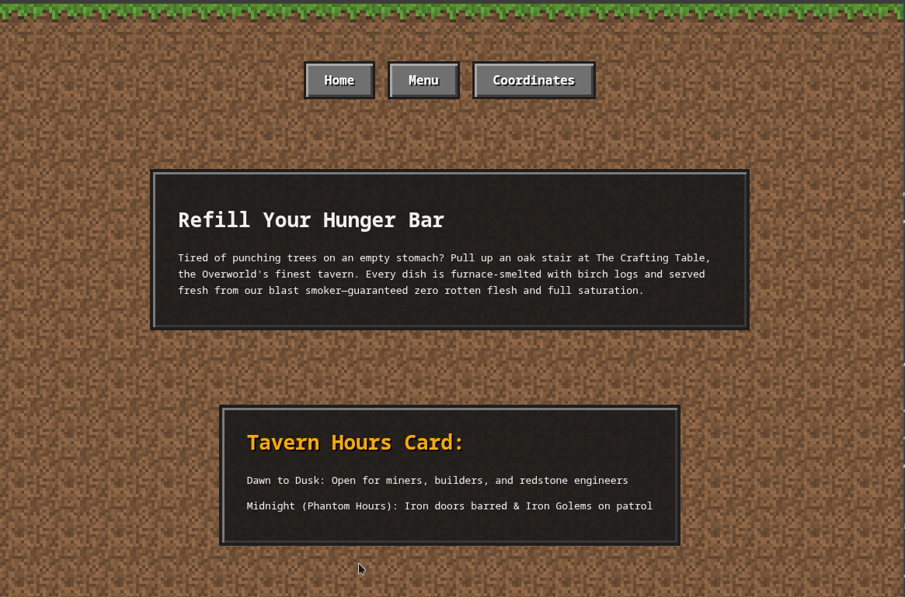

# minecraft-restaurant

[The Crafting Table - Minecraft Restaurant](https://filipnowakway.github.io/minecraft-restaurant/)

A small Minecraft-themed restaurant site for **The Crafting Table**, the Overworld's finest tavern. Browse the menu, check the tavern's coordinates, and see when the kitchen is open — all in a pixel-art style built with vanilla JavaScript and bundled with Webpack.



## Run locally

```bash
npm install
npm run dev
```

Then open the local URL printed by the dev server. To build for production:

```bash
npm run build
```

The output is written to `dist/`.
